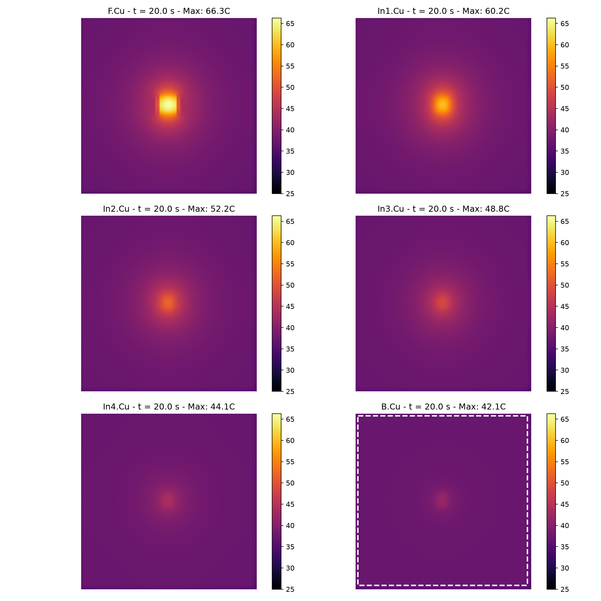
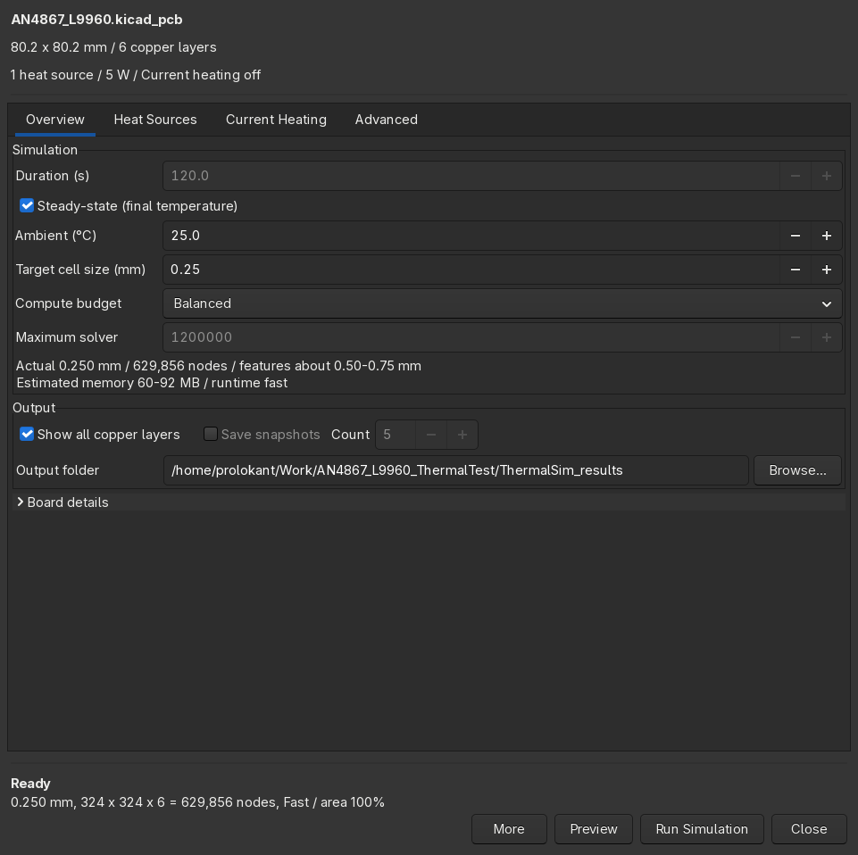
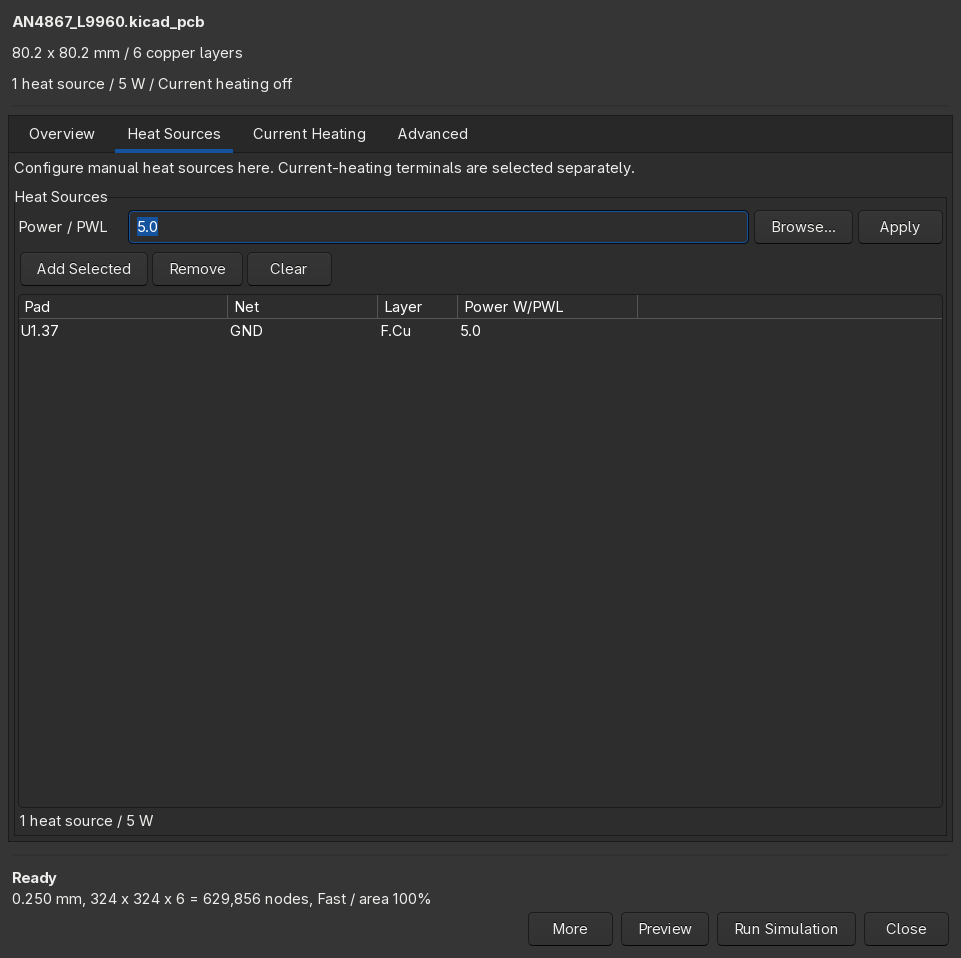
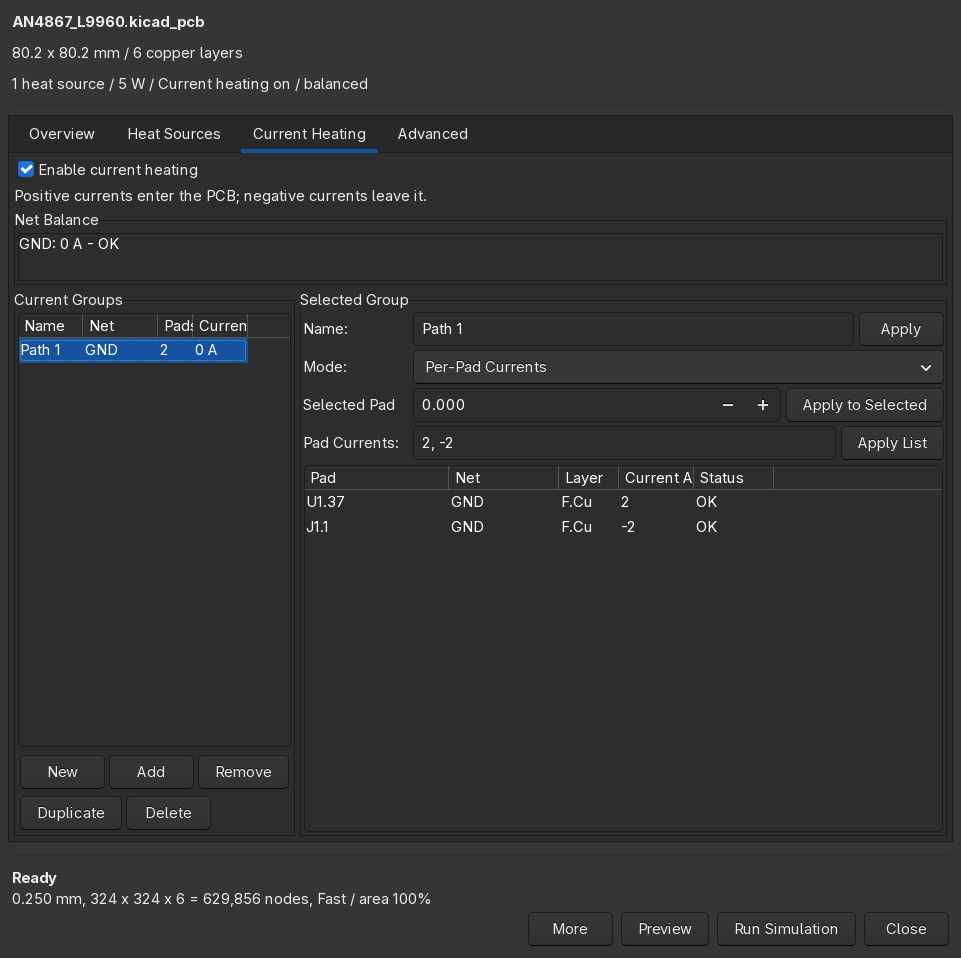
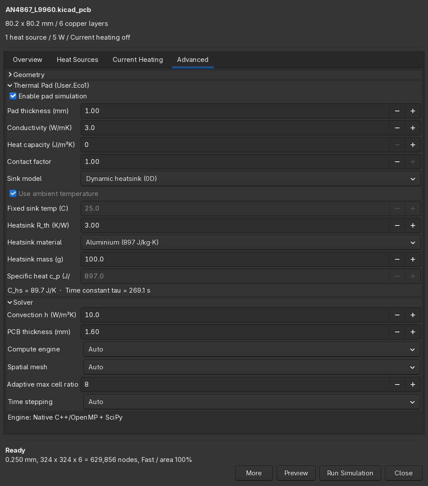
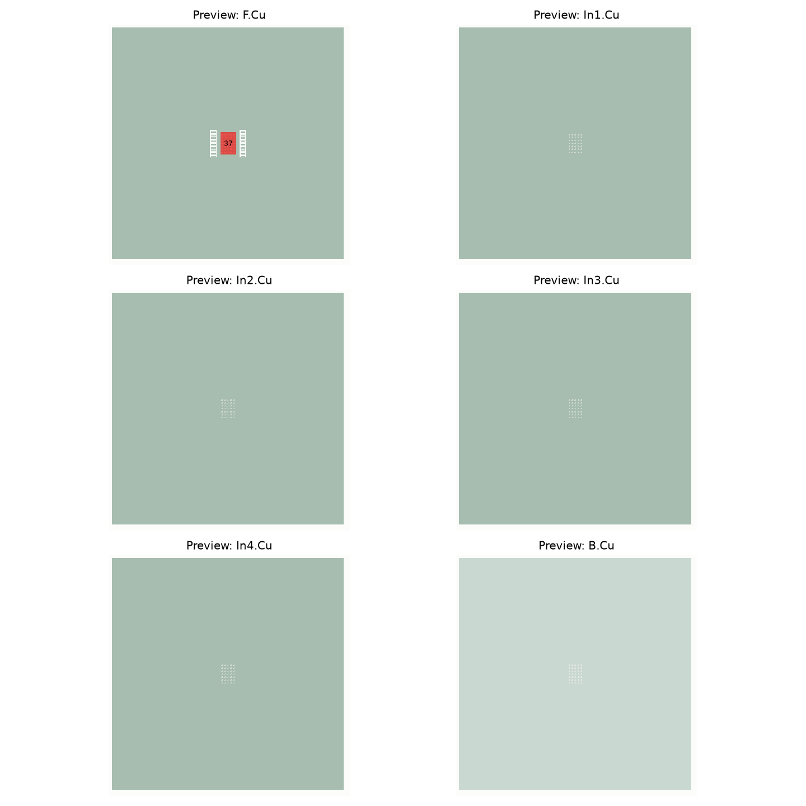
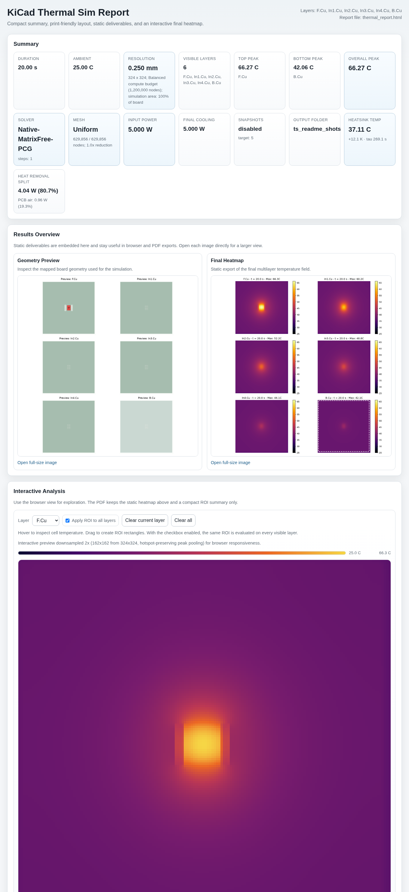

# KiCad Thermal Sim - Fast Multi-Layer Copper Thermal Simulation for KiCad



**KiCad Thermal Sim** is a lightweight KiCad 9.0 & 10.0 PCB Editor plugin for fast, layout-oriented **heat spreading simulation across all copper layers** (`F.Cu` to `B.Cu`, including inner layers).

This is **not** a full 3D CFD/FEA solver. It is intended as a practical engineering tool to quickly answer:

- Where are the **hotspots** on each copper layer?
- How much do **copper pours/planes** and **via stitching** help?
- Which layout variant is **better** in an A/B comparison?
- How does heat distribute through the **stackup**?
- How much extra heat is created by **DC current flow** in copper?
- Which grid settings were actually used when automatic coarsening protects runtime?

---

## What It Simulates

- **2D in-plane conduction** on each copper layer.
- **Vertical coupling** between adjacent copper layers through FR4 and via enhancement.
- **Direct Steady-State (final temperature)** with Full-Multigrid (FMG) warm start and live PCG convergence progress, solving $K \cdot T = Q + b$ directly in a single solve for constant heat sources.
- **Geometric multi-phase transient time integration** (5-phase geometrically growing BDF2 stepping — 5–8x faster on long transients — with linear PCG warm-start extrapolation and lossless early steady-state stop).
- **Native C++/OpenMP v4 Compact Low-RAM Multigrid & Fused PCG core** (`thermalsim_core.dll`, `libthermalsim_core.so`, `libthermalsim_core.dylib`) solving **6M-node steady-state boards in ~5 s at ~725 MB Peak RSS**, with on-the-fly Level-0 mask+LUT evaluation, mixed-precision `float32` multigrid V-cycles, fused OpenMP PCG kernels, and automatic fallback to pure NumPy/SciPy.
- **Manual power injection** from explicitly configured **Heat Sources** (constant power or time-varying **PWL power profiles**) with **exact KiCad 9/10 pad rasterization** (`GetLayerSet()` `B.Cu` SMD pads, rotated & offset pads, and zero FR4 power bleed).
- Optional **DC current-flow heating** from source/sink pads on KiCad nets.
- **Convection** to ambient on top and bottom outer surfaces.
- Optional **Thermal Pad (`User.Eco1`)** geometry with **Fixed temperature** or **Dynamic heatsink (0D)** ($R_{\text{th}}$, mass/material presets, live $C_{\text{hs}}$ & $\tau$, plus **Heatsink Temp** and **Heat Removal Split** in reports).
- **Calibrated RAM & runtime estimates** across Uniform, Adaptive, and Legacy solver modes.
- **Fast scanline zone polygon rasterization** and **continuous cancellable progress** (with elapsed time and English phase ETA) across both **Preview** and **Run**.
- Current-path diagnostics: copper loss, effective resistance, equivalent voltage drop, grid quality, and a Joule loss map.
- Persistent compressed `.npz` disk geometry cache and hotspot-preserving downsampled HTML interactive heatmaps for million-node grids.
- **Headless CLI & AI Agent JSON API** (`inspect`, `validate`, `run`, `sweep`, `compare`, `summary.json`, `schema/*.json`).

---

## Installation

Compatible with **KiCad 9.0** and **KiCad 10.0** on Windows, Linux, and macOS.

### Option A: KiCad Plugin Manager

1. Download the latest `ThermalSim-vX.Y.Z.zip` from the [Releases](https://github.com/PoeAlex/KiCad_Thermal_Sim/releases) page.
2. In KiCad 9.0 or 10.0, open **Plugin and Content Manager**.
3. Click **Install from File...** and select the downloaded ZIP.
4. Restart KiCad.
5. On first run, the plugin detects missing dependencies and offers to install them automatically.

### Option B: Manual Copy

1. Download or clone this repository.
2. Copy the plugin folder (containing `__init__.py`, `thermal_plugin.py`, and the other `.py` modules, plus the optional native shared library if built) into KiCad's plugin directory for your version (`9.0` or `10.0`):

   - **Windows**:
     - KiCad 9.0: `%APPDATA%\kicad\9.0\scripting\plugins\`
     - KiCad 10.0: `%APPDATA%\kicad\10.0\scripting\plugins\`
   - **Linux**:
     - KiCad 9.0: `~/.local/share/kicad/9.0/scripting/plugins/`
     - KiCad 10.0: `~/.local/share/kicad/10.0/scripting/plugins/`
   - **macOS**:
     - KiCad 9.0: `~/Library/Application Support/kicad/9.0/scripting/plugins/`
     - KiCad 10.0: `~/Library/Application Support/kicad/10.0/scripting/plugins/`

3. Restart KiCad.
4. On first run, the plugin offers to install missing packages (`numpy`, `scipy`, `matplotlib`) automatically.

Alternatively, install packages manually in the **KiCad 9.0 / 10.0 Command Prompt** (or your system Python on Linux):

```bash
pip install numpy scipy matplotlib
```

Run the plugin in PCB Editor via **Tools -> External Plugins -> 2.5D Thermal Sim**.

---

## Quick Start

1. Open your PCB in **KiCad PCB Editor**.
2. Select one or more pads if you want to pre-fill manual heat sources.
3. Run **Tools -> External Plugins -> 2.5D Thermal Sim**.
4. Use **Heat Sources** to add pads that dissipate manual power, then enter constant W values or PWL file paths.
5. Choose **Steady-state (final temperature)** or set **Duration**, **Ambient**, and **Resolution** on the **Overview** tab.
6. Optionally use **Current Heating** to add source/sink pads and per-pad currents for copper `I^2R` heating.
7. Optionally use **Advanced** for the simulation area, thermal pad, convection, and solver settings.
8. Click **Preview** to check the mapped geometry, then **Run**.









---

## GUI Settings

The resizable dialog keeps board context and live preflight status visible above and below four compact tabs:

- **Overview** - steady-state toggle, duration, ambient temperature, target cell size, compute budget, live cost estimate, output, and collapsible board details.
- **Heat Sources** - manual heat sources selected independently from current terminals.
- **Current Heating** - DC current source/sink terminals for Joule heating.
- **Advanced** - collapsible simulation-area, thermal-pad, and solver settings.

The header summarizes the board, copper-layer count, heat sources, and current-balance state. The fixed footer shows the requested versus actual grid, readiness warnings, and the main **Preview** and **Run Simulation** actions. Help and settings import/export are available from **More**. After a successful run, the dialog retains maximum temperature, elapsed time, and shortcuts to the report and output folder.

### Overview Tab

#### Board Info

Shows detected copper layers with thicknesses and dielectric gaps parsed from the board stackup. Pads selected when the dialog opened are shown only as a convenience; simulation roles are configured in **Heat Sources** and **Current Heating**.

#### Main Settings

- **Steady-state (final temperature)** - solves $K \cdot T = Q + b$ directly in a single solve for constant heat sources (with FMG warm start and live PCG convergence progress), skipping transient time stepping and solving million-node multilayer PCBs in ~1–5 seconds. Disable this option for transient analysis or time-varying PWL profiles.
- **Duration (sec)** - total simulated time in transient mode. Transient BDF2 uses geometric multi-phase time stepping (`Auto`, 5–8x faster on long transients), linear PCG warm-start extrapolation, and lossless early steady-state stop when temperatures have converged.
- **Ambient Temp (C)** - reference temperature. Results are relative to ambient.
- **Target Cell Size (mm)** - desired spatial grid size. Smaller values improve hotspot and trace localization but increase runtime.
- **Compute Budget** - based on total solver nodes across all copper layers, with an **85% auto-coarsening target** when a requested resolution exceeds the budget:
  - **Fast** - up to **500k** nodes
  - **Balanced** (default) - up to **1.2M** nodes
  - **Detailed** - up to **3M** nodes
  - **Very detailed** - up to **6M** nodes
  - **Custom** - explicit upper limit up to **100M** equivalent uniform nodes (values above 10M are expert settings and may require tens of GB of RAM before adaptive reduction)

The live estimate shows requested versus actual cell size, grid dimensions, total nodes, approximate resolvable feature size, calibrated memory range (distinguishing Uniform, Adaptive, and Legacy solver modes), and a relative runtime class. For large boards, ThermalSim automatically coarsens the requested cell size toward 85% of the selected budget so you keep most of your chosen detail while staying within limits. The report records the requested and actual resolution, compute budget, and simulated board fraction.

#### Output

- **Show All Layers** - display results for all copper layers.
- **Save Snapshots** - store intermediate temperature images (transient mode).
- **Snapshot Count** - number of intermediate snapshots (transient mode).
- **Output Folder** - where the timestamped result folder is created.

#### Settings Files

- **Load Settings...** - load a JSON settings file from any folder and apply it to the open dialog.
- **Save Settings...** - save the current dialog values as a JSON settings file.

ThermalSim also keeps using `thermal_sim_last_settings.json` in the plugin folder for automatic last-used settings. Manual load/save files use the same JSON structure and can be stored per project or per experiment.

### Heat Sources Tab

Manual pad power is configured separately from current-flow terminals.

1. Select pads in KiCad.
2. Click **Add Selected**.
3. Enter a power value or PWL file path in **Power / PWL**.
4. Use **Apply** to write the value to selected table rows. If no row is selected, a comma-separated list is applied in table order.

The Heat Sources table is:

| Column | Meaning |
|--------|---------|
| Pad | Footprint/pad name |
| Net | KiCad net name |
| Layer | Pad layer |
| Power W/PWL | Constant W value or PWL file path |

Accepted power entries:

| Entry | Meaning |
|-------|---------|
| `1.0` | 1 W constant on selected/listed power pads |
| `1.0, 0.5, 2.0` | Per-pad constant power in table order |
| `C:\sim\ramp.pwl` | Same PWL profile for selected/listed pads |
| `1.0, C:\sim\ramp.pwl` | Pad 1 = 1 W constant, Pad 2 = PWL file |

For backward compatibility, pads selected before opening the dialog pre-fill the Heat Sources table when no saved `power_pads` setting exists.

#### PWL File Format

PWL files are LTspice-style text files with two columns:

```text
; Comment lines start with ; or *
; Time(s)  Power(W)
0.0        0.0
0.001      1.0
0.005      2.5
0.010      2.5
0.020      0.0
```

- Time is in seconds.
- Power is in watts.
- Time values must be monotonically increasing.
- Power is linearly interpolated between points and held at the first/last value outside the defined range.

### Current Heating Tab

Enable current heating to calculate copper losses from DC current flow.

1. Select source/sink pads in KiCad.
2. Add them to a current group.
3. Enter positive current for source pads and negative current for sink pads.
4. Make sure every active KiCad net balances to `0 A`.

Current heating is additive with **Heat Sources**:

```text
total heat = manual pad power + calculated Joule copper loss
```

Power pads and current terminals may be different pads. Area limiting remains available with current heating: ThermalSim includes every pad, track, via/PTH, and filled zone belonging to the active current nets, then expands that geometry by the configured thermal margin. A large active plane may therefore require almost the full board.

The report shows **Path Current** as the useful current value. For a `+5 A` source and a `-5 A` sink, the path current is `5 A`. The internal sum of absolute terminal currents (`10 A` in that example) is kept only in raw diagnostics.

### Advanced Tab

#### Geometry Filters

- **Ignore Traces** - exclude copper traces from the conductivity map; zones, pours, and pads still contribute.
- **Limit to Active Sources and Current Paths** - crop the rectangular solver domain around heat sources and complete active current-net geometry.
- **Thermal Margin (mm)** - additional board area around sources and current paths. A practical starting point is 10-30 mm.

The preflight status shows the effective dimensions and percentage of the board. All copper inside the rectangular domain remains part of the thermal model. If active-net geometry cannot be inspected safely, ThermalSim falls back to the full board and reports a warning.

#### Thermal Pad (`User.Eco1`)

- **Enable Pad Simulation** - treat `User.Eco1` geometry as a thermal interface zone with enhanced bottom-side heat removal.
- **Pad Thickness (mm)** - thermal interface thickness.
- **Pad Cond. (W/mK)** - thermal interface conductivity.
- **Pad Heat Cap. (J/m2K)** - additional areal heat capacity.
- **Contact factor** - effective interface contact factor (`0.05`–`1.0`, default `0.2`).
- **Sink model** - choose between two thermal boundary models:
  - **Fixed temperature** - couples the thermal pad to ambient or a custom fixed sink temperature (infinite thermal mass).
  - **Dynamic heatsink (0D)** - couples the thermal pad to a lumped 0D heatsink node with heatsink-to-ambient thermal resistance ($R_{\text{th}}$ in K/W) and optional thermal mass from weight (g) and material preset (**Aluminium**, **Copper**, **Steel**, **Magnesium**, or **Custom** $c_p$). The GUI shows live thermal capacity ($C_{\text{hs}}$) and time constant ($\tau = R_{\text{th}} \cdot C_{\text{hs}}$); setting mass to `0 g` models an instantaneous heatsink. Reports include the heatsink temperature and heatsink-vs-PCB-air heat removal split.

#### Solver

- **Convection h (W/m2K)** - convection coefficient for top/bottom surfaces. Default is 10.
- **PCB Thickness (mm)** - overall board thickness. Stackup thickness is used when available.
- **Compute Engine** - `Auto` selects the matrix-free CPU engine (with FMG-warm-started geometric multigrid PCG) for larger jobs (starting at 50k nodes when the Native C++/OpenMP v4 Compact Low-RAM core is active, or 250k nodes without it) and keeps the sparse SciPy direct solver for small jobs. Both engines remain manually selectable.
- **Spatial Mesh** - `Auto`, `Uniform`, or `Adaptive`:
  - **`Auto`** (default) uses `Uniform` with the Native C++/OpenMP v4 Compact Low-RAM multigrid solver up to **5M nodes** for maximum speed and zero coarsening error, and switches to `Adaptive` above 5M nodes or when running without the native multigrid core.
  - **`Uniform`** keeps the full regular grid.
  - **`Adaptive`** keeps the requested cell size at copper edges, pads, vias, sources, and thermal-pad boundaries while merging homogeneous interiors.
- **Adaptive Max Cell Ratio** - largest adaptive cell relative to the requested cell size. The default is 8.
- **Time Stepping** - `Auto` selects 5-phase geometric BDF2 stepping on matrix-free transient runs (5–8x faster on long transients with lossless steady-state convergence), alongside `Legacy 3-phase`, `2-phase`, and `Uniform BDF2`.
- **Capabilities** - detected solver backend, including the Native C++/OpenMP v4 Compact Low-RAM & Fused PCG core (`thermalsim_core.dll`, `libthermalsim_core.so`, or `libthermalsim_core.dylib`).

The **Balanced** compute budget (1.2M nodes) is the default. Presets use total solver nodes, so a four-layer board automatically receives fewer 2D cells than a two-layer board at the same budget. When auto-coarsening is needed, ThermalSim targets 85% of the budget so headroom is preserved without sacrificing unnecessary resolution.

The fast engine applies the finite-volume operator without constructing a large global COO/CSR matrix. Uniform native runs use the **Native C++/OpenMP v4 Compact Low-RAM & Fused PCG Core** — evaluating Level-0 stencil conductances and capacities on the fly from compact `bool`/`float32` masks and per-layer lookup tables (LUTs), solving mixed-precision `float32` multigrid V-cycle preconditioners inside a fused `float64` outer PCG loop (`6M` nodes steady-state in ~5 s at ~725 MB Peak RSS), and releasing solver scratch/operator caches automatically after each run (and in-memory caches when the dialog closes). Adaptive runs assemble the reduced graph directly from the compact geometry state without materializing fine 3D conductance/capacity arrays. Reports show the equivalent uniform nodes, actual adaptive nodes, reduction factor, PCG iterations, and residual.

---

## Preview

The **Preview** button generates a geometry visualization showing copper distribution, power/current pad locations, via regions, and the effective simulation-area boundary on each layer. Its header reports the cropped dimensions and percentage of the board.

ThermalSim uses the copper-zone fills already stored by KiCad. If zones are stale or unfilled, press **B** in PCB Editor before Preview or Run. The plugin does not refill zones automatically because this can block the interface for minutes on large boards and is unstable in some KiCad builds.

Rasterized board geometry is cached on disk using safe compressed `.npz` archives (no pickle), so repeated previews and parameter sweeps on the same board skip redundant geometry rasterization.



---

## Report Output

Each run creates a timestamped result folder, for example `Thermalsim_20260426_111121/`.

Typical files:

- `thermal_report.html` - main report with summary cards (including **Heatsink Temp** & **Heat Removal Split**), settings, stackup, diagnostics, images, and an interactive ROI heatmap. For million-node grids, the embedded interactive heatmap payload is automatically downsampled using hotspot-preserving pooling so peak temperatures stay accurate while the HTML stays fast and lightweight.
- `thermal_preview.png` - mapped geometry preview.
- `thermal_stackup.png` or `thermal_final.png` - final temperature heatmap.
- `joule_loss_map.png` - current-induced copper loss map when current heating is active.
- `snap_*.png` - optional time-series snapshots (transient mode).
- `summary.json` - semantic machine-readable summary (written by `headless_api` / CLI).



### Current Path Diagnostics

When current heating is enabled, the HTML report includes **Current Path Diagnostics**:

- **Copper Loss** - total calculated Joule heating for active nets.
- **R_eff** - effective resistance, computed from `P / I_source^2`.
- **V_eq** - equivalent voltage drop, computed from `P / I_source`.
- **Source/Sink Current** - source and sink totals per active net.
- **Path Current** - useful current value for the path, not the doubled absolute terminal sum.
- **Net Path Metrics** - terminals, balance, loss, resistance, voltage drop, cell count, edge count, via edges, and copper islands.
- **Current Terminals** - pad positions, matched grid cells, island IDs, and mean potentials.
- **Mapped KiCad Primitives** - pads, tracks, vias/PTHs, zones, track length, and width summary.
- **Joule Loss Map** - per-layer static image of current-induced copper loss.

The report records requested and actual grid resolution, grid size, compute-budget preset, node budget, and the simulated percentage of the board.

---

## Headless CLI & AI Agent Automation

ThermalSim provides a zero-GUI headless CLI and Python API (`headless_api.py`) for AI agents, design-space sweeps, and CI checks. Every CLI command writes **pure JSON to `stdout`** (diagnostic logs go to `stderr`) and requires **no `wxPython` or display server**.

Invoke via module (from the plugin parent directory or with `PYTHONPATH` pointing to the KiCad plugins folder) or directly via `thermalsim_cli.py`:

```bash
python3 -m KiCad_Thermal_Sim <command> ...
# or directly from the repository root:
python3 thermalsim_cli.py <command> ...
```

### Subcommands

1. **`inspect`** — discover stackup, board bounds, zones, `User.Eco1` thermal pads, thermal candidate pads, and solver capabilities:

   ```bash
   python3 -m KiCad_Thermal_Sim inspect board.kicad_pcb --pretty
   ```

2. **`validate`** — preflight-check a job config or CLI flags without running the solver (returns structured errors such as `PAD_NOT_FOUND` with available pad hints):

   ```bash
   python3 -m KiCad_Thermal_Sim validate board.kicad_pcb \
     --pad U1.37=5 --steady-state --amb 115
   ```

3. **`run`** — run a simulation, check thermal limits, and write `summary.json` (plus optional HTML report/plots):

   ```bash
   python3 -m KiCad_Thermal_Sim run board.kicad_pcb \
     --pad U1.37=5 --steady-state --amb 115 \
     --heatsink-rth 3.0 --heatsink-mass 100 --contact-factor 1.0 \
     --limit-board 160 --limit-comp "U1=160" --no-plots --out ./out_a
   ```

4. **`sweep`** — sweep a thermal/design parameter while reusing cached board geometry (defaults to `--no-plots` for speed):

   ```bash
   python3 -m KiCad_Thermal_Sim sweep board.kicad_pcb \
     --param heatsink_rth_kw --values 1,3,5,10 \
     --pad U1.37=5 --amb 115 --steady-state --limit-board 155 --out ./sweep_out
   ```

5. **`compare`** — diff two run directories or `summary.json` files (`delta = B - A` for board, heatsink, layer, and component temperatures plus limit changes):

   ```bash
   python3 -m KiCad_Thermal_Sim compare ./out_a ./out_b --pretty
   ```

### Exit Codes

| Exit Code | Meaning |
|-----------|---------|
| `0` | Success (validation passed, or simulation passed all configured thermal limits) |
| `1` | Unexpected runtime error (`status: "error"`) |
| `2` | Validation error or invalid CLI/config arguments (`valid: false` or `status: "validation_error"`) |
| `3` | Simulation succeeded, but one or more thermal limits were violated (`status: "limit_violation"`) |

### Schemas & `summary.json`

- Input job schema: [`schema/job.schema.json`](schema/job.schema.json) (JSON Schema Draft 2020-12; can be passed via `--config job.json` and overridden with CLI flags).
- Output summary schema: [`schema/summary.schema.json`](schema/summary.schema.json).
- Every `run` writes `summary.json` containing global/per-layer `temperatures`, `heatsink` metrics, `components` & `top_components`, spatially separated `hotspots` with `nearest_component` attribution, `limits_check` pass/fail details, `electrical` metrics, and `solver` diagnostics.

---

## How to Interpret Results

This tool is most reliable for:

- **Relative comparisons** between layout variants.
- **Hotspot locations**.
- Trends from more copper, more vias, wider traces, or better spreading.
- Order-of-magnitude current-path loss and resistance diagnostics.

Absolute temperatures are **estimates** and depend strongly on modeling assumptions, grid resolution, board environment, airflow, and component/package thermal paths.

---

## Architecture

The plugin is split into focused modules:

| Module | Purpose |
|--------|---------|
| `simulation_core.py` | Zero-`wx` single source of truth for board area/grid estimation, calibrated RAM/runtime cost estimation, stackup thickness derivation, capacity assembly, and sparse pad power distribution |
| `capabilities.py` | Runtime detection of `numpy`, `scipy`, `matplotlib`, `wx`, and the Native C++/OpenMP v4 core |
| `dependency_installer.py` | Auto-install dialog for missing packages via pip |
| `stackup_parser.py` | Parse copper/dielectric layers from `.kicad_pcb` S-expressions |
| `gui_dialogs.py` | wxPython dialog for simulation parameters |
| `geometry_mapper.py` | Accurately rasterize tracks, arcs, rotated/offset SMD & THT pads (`GetLayerSet()`), vias, and fast scanline filled zones |
| `adaptive_mesh.py` | Build conservative adaptive meshes and geometric multigrid operators |
| `electrical_solver.py` | Solve DC current flow and convert copper losses to heat sources |
| `thermal_solver.py` | Direct steady-state, FMG-preconditioned PCG, geometric transient BDF2, and Dynamic 0D Heatsink (Sherman-Morrison) solvers |
| `native_core.py` | Cross-platform loader (`ctypes`) for the optional Native C++/OpenMP v4 Compact Low-RAM & Fused PCG core |
| `native/thermalsim_core.cpp` | C++/OpenMP v4 stencil, mixed-precision `float32` multigrid, and fused `float64` PCG kernels |
| `workflow.py` | Safe compressed `.npz` disk geometry caching, operator caching, and preflight state |
| `pwl_parser.py` | Parse LTspice-style PWL power profiles |
| `visualization.py` | Generate fast PNG thermal plots, previews, hotspot-preserving interactive heatmaps, and Joule loss maps |
| `thermal_report.py` | Generate the HTML report |
| `thermal_plugin.py` | Orchestrate workflow, background progress/ETA, and KiCad ActionPlugin integration |
| `headless_api.py` | Zero-GUI headless API (`inspect`, `validate`, `run`, `sweep`, `compare`) and semantic `summary.json` builder |
| `thermalsim_cli.py` | Agent-friendly JSON CLI entrypoint with strict stdout/stderr separation and semantic exit codes |
| `__main__.py` | Module entrypoint for `python3 -m KiCad_Thermal_Sim` |
| `schema/` | JSON Schemas (`job.schema.json`, `summary.schema.json`) for headless automation |

---

## Limitations

- No explicit component/package thermal model; junction-to-case-to-pad behavior is not modeled.
- Convection is simplified as uniform top/bottom ambient coupling.
- Radiation is not modeled.
- Current-flow heating is static DC only; AC effects, skin effect, and temperature-dependent copper resistance are not modeled.
- Current-path accuracy depends on grid resolution; narrow traces and small pads may need a finer grid to match hand calculations closely.
- Very fine requested resolutions may be auto-coarsened when the selected compute budget is exceeded.
- Via coupling is an approximation.
- Results depend strongly on **Target Cell Size**, **Compute Budget**, and the selected simulation area and thermal margin.
- Thermal Pad (`User.Eco1`) is a simplification of real contact pressure, interface quality, and sink temperature.

---

## Suggested Workflow

1. Add manual dissipating components in **Heat Sources**.
2. Add source/sink terminals in **Current Heating** only when copper `I^2R` heating matters.
3. Press **B** in PCB Editor so every copper zone has a current fill.
4. Enable **Steady-state (final temperature)** for fast constant-power design iterations, or set **Duration** for transient/PWL studies.
5. Enable **Limit to Active Sources and Current Paths** and start with a moderate thermal margin, for example 20 mm.
6. Check the effective board percentage; active current nets are always included completely.
7. Tune **Target Cell Size** until hotspots and current-path metrics are stable. Try 0.5 mm, then 0.3 mm.
8. Increase the **Compute Budget** only after checking the live node, memory, and runtime estimate.
9. Save JSON settings for repeatable project comparisons.
10. Compare layout variants using the same settings and validate important designs with measurement or a full 3D thermal workflow.

---

## Building the Native C++/OpenMP v4 Compact Low-RAM & Fused PCG Core

The optional native C++/OpenMP v4 core accelerates matrix-free stencil evaluation, geometric multigrid V-cycles, and fused `float64` PCG vector/dot kernels across all CPU cores while minimizing peak RAM (`6M` nodes steady-state in ~5 s at ~725 MB Peak RSS):

- **On-the-fly Level-0 mask + LUT evaluation** avoids allocating dense 3D `float64` conductance (`gx`/`gy`/`gz`), capacity (`C`), boundary (`b`), and convection (`hA`) arrays.
- **Mixed-precision multigrid with FMG warm start** runs `float32` V-cycle smoothing, restriction, and prolongation inside a fused `float64` outer PCG loop (`apply_compact_dot_native`, `pcg_update_xr_norm2_native`, `pcg_update_p_native`, `f64_to_f32_native`, `f32_to_f64_dot_native`).
- **Direct adaptive mesh assembly** builds reduced adaptive graphs straight from compact masks and layer lookup tables without building a full fine operator first.
- **Automatic post-run cache cleanup** frees native scratch buffers and operator caches after each solve, and releases in-memory caches when the plugin dialog closes.

Without the native library, the same fast-engine interface runs seamlessly on NumPy/SciPy.

### Windows (CMake / MSVC)

Install Visual Studio Build Tools with the C++ workload, then run:

```bash
cmake -S native -B native/build
cmake --build native/build --config Release
```

This produces `native/bin/thermalsim_core.dll`.

### Linux (CMake or `g++`)

Using CMake:

```bash
cmake -S native -B native/build -DCMAKE_BUILD_TYPE=Release
cmake --build native/build
```

Or directly with `g++`:

```bash
mkdir -p native/bin
g++ -O3 -fno-fast-math -fopenmp -shared -fPIC -std=c++17 native/thermalsim_core.cpp -o native/bin/libthermalsim_core.so
```

This produces `native/bin/libthermalsim_core.so`.

### macOS (CMake or `clang++`)

Using CMake (install `libomp` via Homebrew for OpenMP multithreading):

```bash
cmake -S native -B native/build -DCMAKE_BUILD_TYPE=Release
cmake --build native/build
```

Or directly with `clang++`:

```bash
mkdir -p native/bin
clang++ -O3 -fno-fast-math -shared -fPIC -std=c++17 native/thermalsim_core.cpp -o native/bin/libthermalsim_core.dylib
```

This produces `native/bin/libthermalsim_core.dylib`.

Any built binaries in `native/bin/` (`thermalsim_core.dll`, `libthermalsim_core.so`, `libthermalsim_core.dylib`) are packaged automatically by `build_pcm_package.py`.

---

## Testing

Run the test suite from the repository root:

```bat
run_tests.bat
```

Or on Linux/macOS:

```bash
python3 run_tests.py -v
```

Run the synthetic large-grid benchmark without a proprietary board file:

```bash
python benchmark_fast_engine.py --nodes 10000000 --layers 4 --solve-steps 3
```

Legacy matrix construction is automatically skipped above the configured safety limit. The benchmark reports equivalent/adaptive node counts, operator build times, solve time, iteration counts, and process memory.

Useful test variants:

```bat
run_tests.bat -k "test_thermal_solver"
run_tests.bat -m physics
run_tests.bat --cov=ThermalSim
```

### Real KiCad Benchmark

Use KiCad's bundled Python (KiCad 9.0 or 10.0) to benchmark a real board without saving or modifying it:

```powershell
& "C:\Program Files\KiCad\10.0\bin\python.exe" benchmark_real_board.py `
  "C:\path\to\board.kicad_pcb" --scenario thermal --time-stepping auto
```

On Linux (using system Python with KiCad 9.0/10.0 `pcbnew`):

```bash
THERMALSIM_HEADLESS=1 python3 benchmark_real_board.py \
  /path/to/board.kicad_pcb --scenario thermal --time-stepping auto
```

Set `THERMALSIM_HEADLESS=1` when importing ThermalSim as a library outside PCB Editor. This prevents ActionPlugin registration while keeping the solver and board readers available.

---

## License / Disclaimer

MIT License

This plugin provides engineering estimates intended for fast iteration and comparative analysis. For safety-critical or thermally constrained designs, validate with measurement and/or a full 3D thermal tool.
